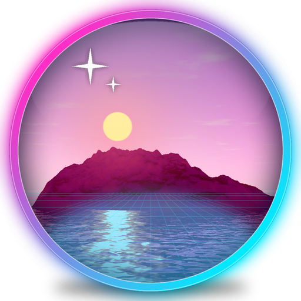
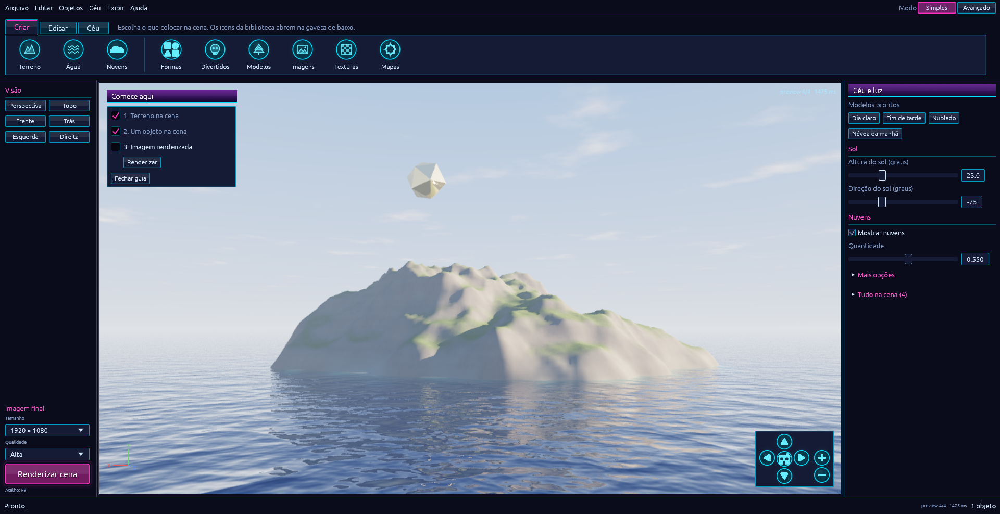
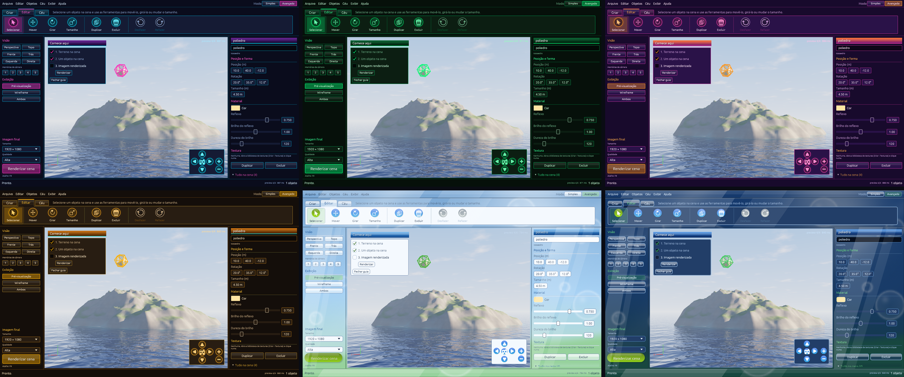
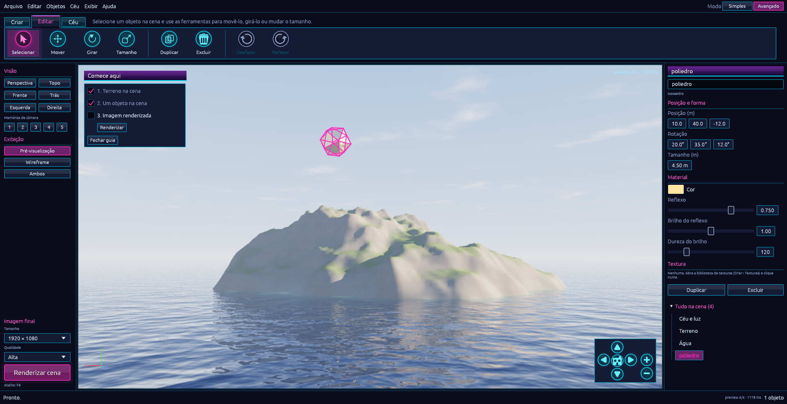
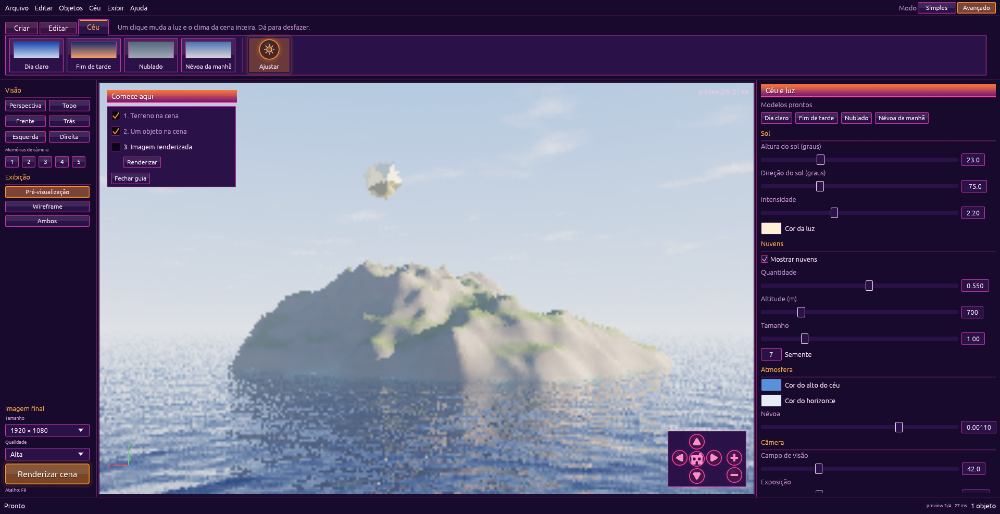
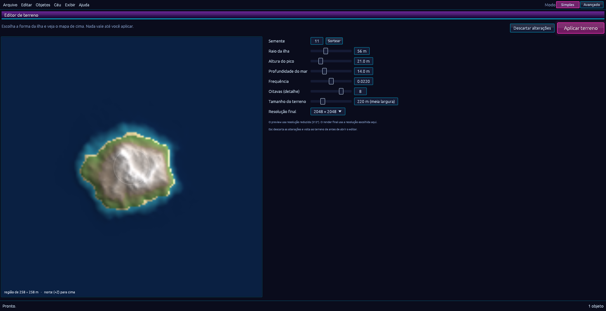
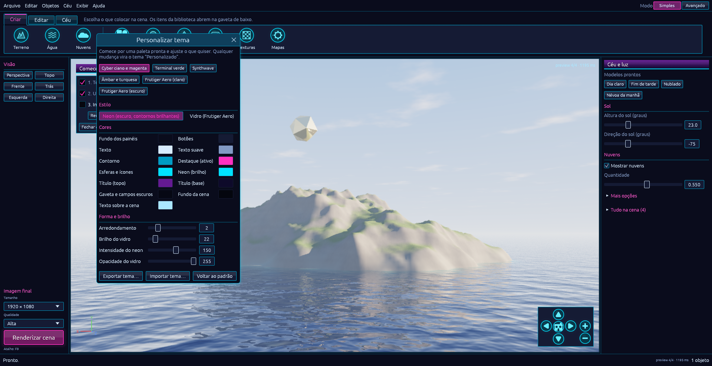
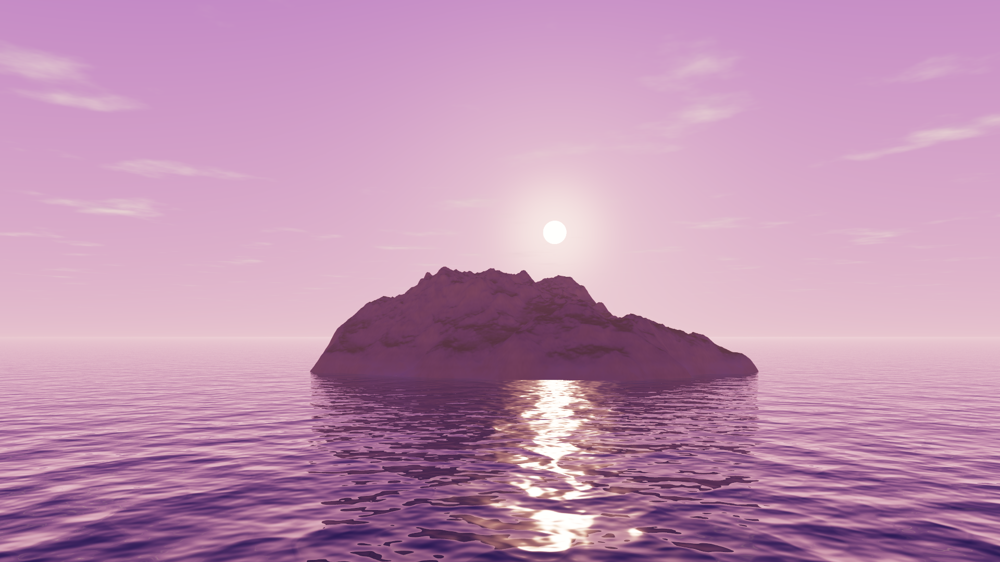
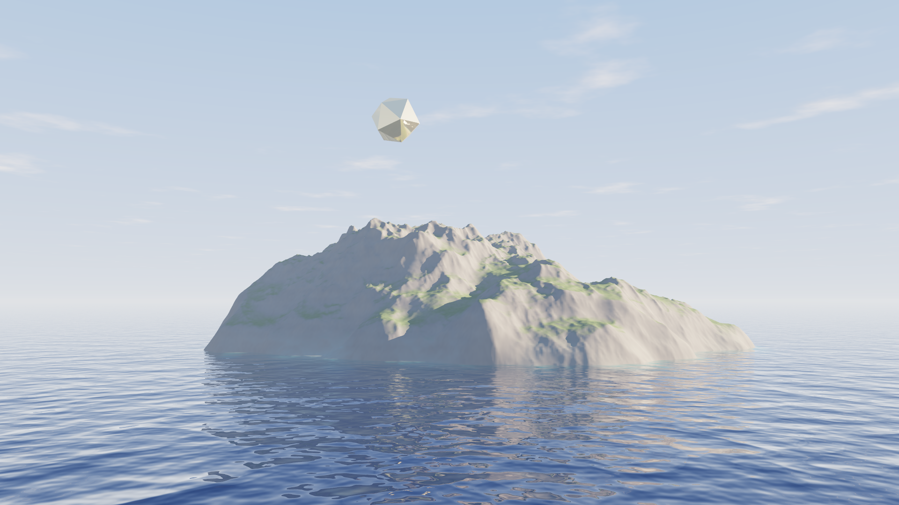

<p align="center">
  
</p>

<h1 align="center">Terralux Studio</h1>

<p align="center">
  <b>Gerador de paisagens 3D procedurais em Rust</b> — céu, água, terreno e nuvens, com preview ao vivo,<br>
  renderizador próprio e uma interface de vidro e neon que muda de cor ao seu gosto.<br>
  <sub>Linux · Windows 11 · projeto clean-room</sub>
</p>

<p align="center">
  
</p>

## Em resumo

- **Cena viva**: terreno procedural, oceano com ondas e reflexo, céu com sol e nuvens, formas e objetos divertidos (caveira, ossos…).
- **Dois modos**: *Simples* (poucos botões grandes) e *Avançado* (posição exata, material completo, memórias de câmera, wireframe).
- **Renderizador próprio** (ray tracer em CPU, multi-thread) pela interface (F9) ou pela linha de comando.
- **Temas**: cybercore ciano e magenta (padrão), terminal verde, synthwave, âmbar, **Frutiger Aero claro e escuro** com painéis de vidro translúcido, e um tema **totalmente personalizável** (exporta e importa).

<p align="center">
  <br>
  <sub>Os seis temas prontos: ciano, matriz, synthwave, âmbar, Aero claro e Aero escuro.</sub>
</p>

<table>
  <tr>
    <td><br><sub>Modo avançado</sub></td>
    <td><br><sub>Céu e luz</sub></td>
  </tr>
  <tr>
    <td><br><sub>Editor de terreno</sub></td>
    <td><br><sub>Editor de tema: cada cor, estilo, brilho e vidro</sub></td>
  </tr>
</table>

## Renders

<p align="center">
  
  
</p>

## Instalar

Baixe o pacote da sua plataforma na página de [Releases](../../releases) e extraia:

- **Linux** (`terralux-vX.Y.Z-linux-x86_64.tar.gz`): `./terralux-studio`. Em `packaging/linux/` há um `.desktop` e o ícone para o menu de aplicativos.
- **Windows 11** (`terralux-vX.Y.Z-windows-x86_64.zip`): abra `terralux-studio.exe`. O executável não é assinado; o SmartScreen pode avisar (*Mais informações → Executar assim mesmo*).

Ou compile (Rust estável; no Linux precisa de `libxkbcommon`, `wayland`, `libgl` e `libx11` de desenvolvimento):

```bash
cargo build --release
./target/release/terralux-studio              # abre com a cena de exemplo
./target/release/terralux example > scenes/ilha.ron
./target/release/terralux render scenes/ilha.ron --width 3840 --height 2160 --spp 16 -o ilha4k.png
```

## Como usar

**Controles (estilo Blender)** — **F1** abre a cola completa dentro do programa.

| Ação | Atalho |
|---|---|
| Orbitar · deslocar · zoom | botão do meio · Shift + meio · roda ou Ctrl + meio (Alt + esquerdo no touchpad) |
| Vistas | `1` frente · `3` direita · `7` topo (com Ctrl, o lado oposto) · `0` perspectiva · `.` enquadra a seleção · `Home` enquadra tudo |
| Mover · girar · escalar | `G` · `R` · `S` — depois `X`/`Y`/`Z` fixa o eixo e dá para digitar o valor (`G` `X` `5` `Enter`); `Esc` ou botão direito cancela |
| Adicionar · duplicar · excluir | `Shift+A` · `Shift+D` (duplica e move) · `X` ou `Delete` |
| Janela | `N` propriedades · `T` vistas · `Z` alterna pré-visualização/wireframe · `Tab` modo Simples/Avançado |
| Arquivo | `Ctrl+N` / `O` / `S` · `Ctrl+Shift+S` · `Ctrl+Z` / `Ctrl+Shift+Z` · `F12` renderiza |

**Como a janela é organizada**:
- **Paleta por abas** no alto: *Criar* (terreno, água, nuvens e a biblioteca), *Editar* (ferramentas, duplicar, excluir, desfazer) e *Céu* (quatro climas prontos).
- **Biblioteca em gaveta** embaixo: abre ao clicar num item de *Criar*, fecha com Esc.
- **Coluna esquerda**: vistas de câmera e imagem final (tamanho, qualidade, *Renderizar cena*).
- **Painel direito**: o que está selecionado e o que dá para mudar.
- **Modo Simples / Avançado** (canto superior direito, lembrado entre sessões): o simples mostra poucos controles grandes; o avançado libera posição exata, material completo, memórias de câmera, wireframe e gels.
- O guia *Comece aqui* acompanha os três primeiros passos e pode ser fechado (reabre em Ajuda).

Para testar o layout sem abrir a janela: `--screenshot arq.png 6 --size 1280x800 [--mode simples|avancado] [--palette criar|editar|ceu] [--library formas|divertidos|terrenos|modelos|texturas|imagens|gels]`.
(Usa X11/XWayland por padrão; `TERRALUX_WAYLAND=1` liga o Wayland nativo.)

## Projeto

Crates: `terralux-core` (cena, ruído, heightfield), `terralux-render` (ray tracer CPU), `terralux` (CLI), `terralux-studio` (interface, egui).
Docs: `docs/FEATURES.md` (lista-alvo), `docs/ROADMAP.md` (marcos). Projeto **clean-room**: nada do software que o inspirou é copiado, e o nome é provisório.

## Biblioteca de assets

O painel esquerdo do `terralux-studio` tem as abas Formas, Divertidos (caveira, osso, ossos cruzados, geometria própria do Terralux), Terrenos, Modelos, Texturas, Imagens e Gels.

- Os assets do CD original **não** estão neste repositório e **não** devem ser distribuídos com o programa. O Terralux os lê, em tempo de execução, da pasta que o usuário indicar (botão "Pasta…", variável `TERRALUX_LIB` ou `~/.config/terralux/library.txt`; por padrão, `~/Documents/Bryce3D/cdrom`). Sem a pasta, só as formas internas ficam disponíveis.
- Formatos abertos aceitos: modelos OBJ+MTL e DXF (3DFACE), imagens TIF/PNG/JPG (inclusive TIF de paleta), mapas de terreno em tons de cinza.
- **Não suportados**: `.obp`, `.mat`, `.bsk` e `.br3` (formatos fechados do original; exigiriam engenharia reversa, fora do escopo clean-room).
- As miniaturas ficam no cache XDG do usuário, nunca no repositório.
- Os Gels (projeção em luzes) ainda não estão ligados ao renderizador; a aba só lista os arquivos.

Opções de depuração: `terralux-studio --screenshot saida.png <segundos> [--library <aba>] [--insert <nome>]...` (repetível).

Temas: menu **Exibir → Tema** (Cyber ciano e magenta, Terminal verde, Synthwave, Âmbar e turquesa, Frutiger Aero claro e escuro, com painéis de vidro translúcido sobre um papel de parede com bolhas) e **Personalizado…**, que edita cada cor, o estilo (neon ou vidro), arredondamento, brilho, intensidade do neon e opacidade do vidro, com exportar e importar (`.tema`). A escolha fica em `tema.txt` na pasta de configuração. Para testes: `--theme <ciano|matriz|sintetico|ambar|aero|aeroescuro>` (não grava) e `--theme-window`.

## Créditos

Ícone e logo do app: feitos para o Terralux, com uma cena renderizada pelo próprio renderizador. No tema Frutiger Aero (e em alguns ícones), esferas, cápsulas e ícones brancos: **AeroMedia: Frutiger Aero UI**, de OnNOff (<https://onnoff.itch.io/aero-media>), licença [CC BY 4.0](https://creativecommons.org/licenses/by/4.0/); recortados e redimensionados. Detalhes em `crates/app/assets/aero/CREDITS.md`. Os demais ícones são desenhados por código.
